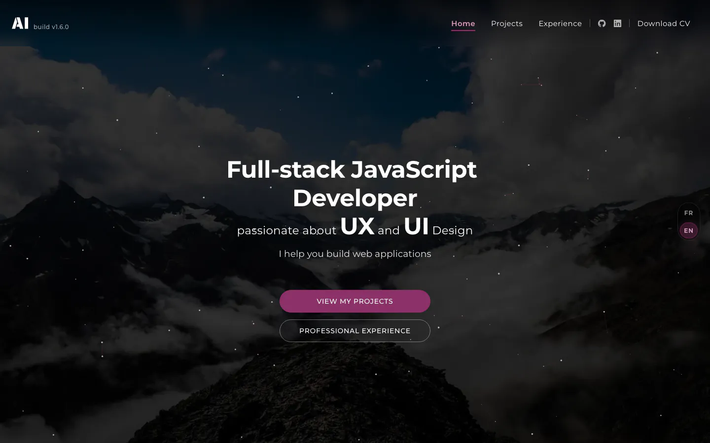
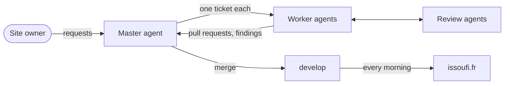

# issoufi.fr

[](https://github.com/AIssoufi/issoufi.fr/actions/workflows/ci.yml)
[](https://github.com/AIssoufi/issoufi.fr/actions/workflows/deploy-production.yml)

The portfolio of **ADAM Issoufi**, full-stack JavaScript developer.
A bilingual React app, built and maintained with a team of AI agents.

**Live: [issoufi.fr](https://issoufi.fr/)** · [English version](https://issoufi.fr/en/)

<a href="https://issoufi.fr/en/"></a>

[Highlights](#highlights) · [Tech stack](#tech-stack) · [AI workflow](#ai-workflow) · [Getting started](#getting-started) · [Documentation](#documentation)

## Highlights

- **Fast and accessible**: Lighthouse 100 in accessibility, best practices and SEO, 98 to 100 in performance.
- **Tested in depth**: over 5,000 unit tests at 100 % coverage, and over 600 browser tests in Chromium, from phones to large screens.
- **A page per route**: each page gets its own HTML file in each language, with its title, description, preview image and structured data, for search engines and link previews.
- **Shipped every morning**: a scheduled workflow releases `develop` and deploys it to production.
- **Built with AI agents**: one Claude agent per ticket, each change reviewed by other agents.

## Tech stack

| Area           | Tools                                            |
| -------------- | ------------------------------------------------ |
| UI             | React 19, TypeScript 5                           |
| Build          | Vite 8                                           |
| Styles         | styled-components with xstyled design tokens     |
| Routing, i18n  | React Router 8, i18next (French, English)        |
| Tests          | Vitest, Testing Library, Playwright, axe-core    |
| Hosting, CI/CD | Cloudflare Pages, GitHub Actions, release-please |

## AI workflow



- A **master agent** turns requests and findings into tickets, then merges the pull requests.
- A **worker agent** delivers each ticket in its own Git worktree.
- **Review agents** check each change: one against the conventions, one in a browser.
- A **lessons journal** turns mistakes into rules, tests or hooks, so that they do not happen twice.

More in [AI workflow](docs/ai-workflow.md).

## Getting started

Requires Node.js 24 and pnpm 10.

```bash
pnpm install
pnpm dev                 # http://localhost:3000
pnpm test                # unit tests
pnpm build               # production build in dist/
pnpm test:browser        # browser tests, after a build
```

The browser tests need Chromium once: `pnpm exec playwright install --only-shell chromium`.

## Documentation

| Guide                                | Content                                  |
| ------------------------------------ | ---------------------------------------- |
| [Development](docs/development.md)   | Setup, scripts and checks                |
| [Architecture](docs/architecture.md) | How the app and its pages are built      |
| [Assets](docs/assets.md)             | Images, fonts, icons and the CV          |
| [Testing](docs/testing.md)           | Unit and browser tests                   |
| [Deployment](docs/deployment.md)     | CI, hosting and the daily deploy         |
| [Releases](docs/releases.md)         | Versions, changelog and standalone build |
| [Conventions](docs/conventions.md)   | Git, code, styles and accessibility      |
| [AI workflow](docs/ai-workflow.md)   | Agents, reviews and lessons              |
