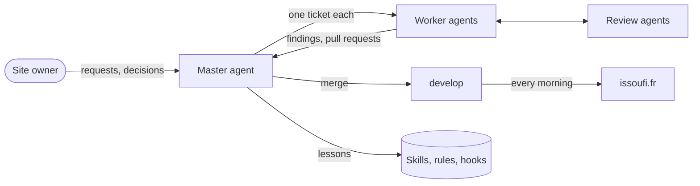

# AI workflow

The site owner decides. A team of [Claude Code](https://claude.com/claude-code) agents plans, implements, reviews and ships.
The agents, skills and hooks live in the Claude Code setup of the owner; this repository holds their work.

## Master and workers

- **The master agent** runs on `develop`, in the main checkout. It never implements a ticket.
- It turns the requests of the owner and the findings of the workers into tickets, after looking for duplicates.
- It gives each ticket to a worker, answers its questions, and merges its pull request once the CI and the reviews pass.
- **Each worker** owns one ticket, in its own Git worktree, with its own port. Several workers build and test at the same time.
- A worker implements its ticket with its tests, rebases on `develop`, runs the reviews and opens the pull request.
- What a worker sees outside its ticket, a bug, debt or an outdated package, goes to the master as a finding.

## Reviews by agents

Before each pull request, two independent agents check the change:

| Agent                | Checks                                                                          |
| -------------------- | ------------------------------------------------------------------------------- |
| Conventions reviewer | the diff against every rule, then the lint, the types and the tests             |
| Visual tester        | the app in Chrome, at desktop and mobile widths, when something visible changed |

The worker checks each finding, fixes it, and has the reviewer check the fix.

## Skills, lessons and hooks

- **Skills** hold the conventions of the code, such as the structure of a component or the design tokens. They load when they apply.
- **The lessons journal** records each mistake of an agent, its cause and its prevention.
  The prevention becomes a skill, a rule, a test or a hook, so that the mistake does not happen twice.
- **A hook** refuses a shell command whose next step would run on the exit code of a filter, such as `tail`, rather than on the check before it. It came from such a lesson.
- **`CLAUDE.md`** keeps the rules that the code does not show, one line each.

## Guardrails in the repository

A rule that matters is also checked by the code, so an agent that misses it fails the CI:

- a test refuses a raw value in a style file;
- ESLint refuses a relative import without its extension, a direct `styled-components` import, a `ul` outside `List`, a link to a new tab outside `NewTabLink` and a comment line over 100 characters;
- the specs check each page and every generated file;
- the browser tests check the layout, the accessibility and the security policy.
