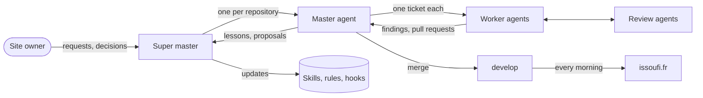

# AI workflow

The site owner decides. A fleet of [Claude Code](https://claude.com/claude-code) agents plans, implements, reviews and ships.
The agents, skills and hooks live in the Claude Code setup of the owner (`~/.claude`); this repository holds their work.

## Topics

| File                                    | Content                                                                                             |
| --------------------------------------- | --------------------------------------------------------------------------------------------------- |
| [Roles](roles.md)                       | The owner, the super master, the masters, the workers and the sub-agents, and what each one decides |
| [Life of a ticket](ticket-lifecycle.md) | From a finding to an issue, a worker, a pull request, a merge and the daily deploy                  |
| [Reviews](reviews.md)                   | The conventions review, the visual test, and what waits for the owner                               |
| [Journal and lessons](journal.md)       | What the fleet journal and the lessons journal record, and why                                      |
| [Tooling](tooling.md)                   | Claude Code, cmux, Worktrunk and its hooks, commitlint, the CI and Cloudflare in this repository    |

## Guardrails in the repository

A rule that matters is also checked by the code, so an agent that misses it fails the CI:

- a test refuses a raw value in a style file;
- ESLint refuses a relative import without its extension, a direct `styled-components` import, a `ul` outside `List`, a link to a new tab outside `NewTabLink` and a comment line over 100 characters;
- knip refuses a file that no entry point reaches, an export that no other module imports (a type that its own file uses may stay) and a dependency that nothing uses;
- the specs check each page and every generated file;
- the browser tests check the layout, the accessibility and the security policy.

The rules that the code does not show are in [`CLAUDE.md`](../../CLAUDE.md), one line each, and their reasons in [conventions](../conventions.md).
