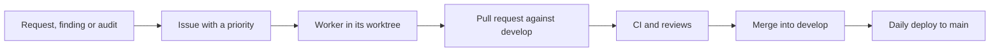

# Life of a ticket

## 1. An issue

A ticket starts from a request of the owner, a `FINDING:` of a worker or a finding of the auditor. The master looks for a duplicate, then writes the issue in English with its context, its evidence, a proposed solution and its acceptance criteria, and adds it to the GitHub project of the repository. The reference of a ticket, such as `ISF-35`, is the autolink of issue `#35`.

The `Priority` field of the project orders the work:

| Priority | For                                                                                     |
| -------- | --------------------------------------------------------------------------------------- |
| P0       | a broken build or deploy, the site down, a secret in the code, an exposed vulnerability |
| P1       | a bug a visitor sees, a missing CI check                                                |
| P2       | migrations, dead tools, missing tests, technical debt                                   |
| P3       | improvements and polish                                                                 |

Within a priority, what unblocks other tickets goes first, then the cheapest. Two tickets that touch the same files never run at the same time.

## 2. A worker

The master starts the worker with `ticket.mjs start <ticket> --agent` (`ticket-worktree` skill): a Worktrunk worktree in `~/Sources/worktrees.noindex/<repo>.<ticket>` (`AIssoufi.github.io.ISF-35`), a branch named after the ticket, a cmux workspace and a Claude session in it. The worktrees sit apart from the main checkout, in a folder whose `.noindex` suffix makes Spotlight skip it, so that macOS does not index the `node_modules` and the builds of each one; `ticket.mjs` finds them through `git worktree list`. The effort of the session follows what the ticket asks: the most for architecture, the build or the CI, less for docs or a mechanical change.

## 3. A pull request

The worker commits with Conventional Commits and a `Refs:` footer, runs the [reviews](reviews.md), rebases on `develop` (never a merge), and opens the pull request against `develop`, with `Closes #<number>`, its test plan and the review verdict. It waits for the CI and fixes it, then sends `DONE:`.

## 4. The merge

The master checks the pull request on GitHub rather than trusting the message: a green CI, a mergeable branch, a diff that matches the ticket and a review verdict. It merges one pull request at a time, with a merge commit whose body is `Closes #<number>`, so that release-please does not list a change twice. Then it deletes the branch, tells the other workers that `develop` moved, and removes the finished worktree and workspace. After a merge, or after parking a worker that waits for its CI, it runs `ticket.mjs next-turn` to hand the freed slot to a waiting master ([messages](roles.md#messages)).

## 5. The deploy

A merge does not reach the site at once. Every morning, a scheduled workflow releases `develop` to `main`, which deploys issoufi.fr ([deployment](../deployment.md), [releases](../releases.md)).
